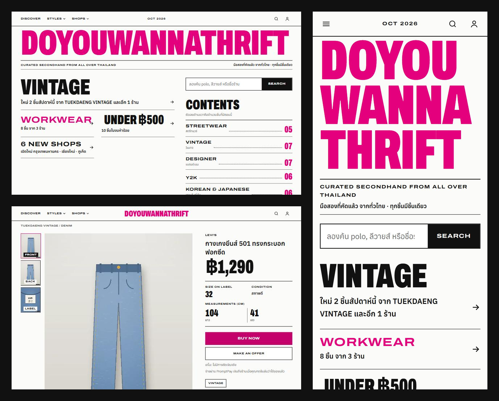

# Doyouwannathrift

**A marketplace demo for discovering one-of-a-kind secondhand clothing from shops across Thailand.** The storefront takes its cues from a street-style magazine. Every listing gives buyers the photos, measurements, and condition details they need to decide if a piece is right for them.

**[Try the live demo](https://doyouwannathrift.vercel.app/)** · [Discover new arrivals](https://doyouwannathrift.vercel.app/discover) · [Browse shops](https://doyouwannathrift.vercel.app/shops)

> เว็บเดโมรวมร้านเสื้อผ้ามือสองจากทั่วไทย เลือกดูตามสไตล์ งบ หรือจังหวัด แล้วเช็กรูป ขนาดจริง และตำหนิก่อนกดซื้อหรือยื่นข้อเสนอ



## My role

I built this as a solo portfolio project. I designed the storefront and the buyer, shop, and admin workflows, built the app with Next.js and Supabase, and deployed the demo to Vercel.

## Try the demo

On the [sign-in page](https://doyouwannathrift.vercel.app/account), select **TRY AS BUYER**, **TRY AS SHOP**, or **TRY AS ADMIN** to explore without signing up.

| Role | What to try |
| --- | --- |
| **Buyer** | Browse by style or province, or filter by size and budget. Inspect photos and measurements, then try Buy Now or Make an Offer. |
| **Shop** | Apply to open a shop, publish listings with four required photo views, respond to offers, and add tracking to demo orders. |
| **Admin** | Review shop applications, resolve reports, and reset the demo data. |

The shops and listings are fictional. Product photos are illustrations, and checkout, shipping, and payouts are simulated.

## How it works

- **Listings show the details that matter for secondhand clothing.** Buyers see the front, back, brand label, and flaws alongside measurements in centimeters. The browser resizes uploaded photos to WebP. The [design system](DESIGN.md) documents the Thai typography, bold masthead, and magazine layout.
- **Postgres enforces the trading rules.** Database functions handle offer rounds, payment holds, and order transitions. Row-level security controls which records each role can access. The app checks expiry timestamps when relevant actions run. [Database migrations](supabase/migrations)
- **Public browsing stays fast.** Next.js Cache Components cache public pages, and session-dependent UI streams in behind React Suspense.
- **Database tests exercise the policies.** PGlite runs the migrations and tests access as anonymous and authenticated users. Vitest and Testing Library cover app behavior. [Database tests](src/db/__tests__)

## Tech stack

| Area | Tools |
| --- | --- |
| Web app | Next.js 16 App Router, React 19, TypeScript, Tailwind CSS 4 |
| Backend | Supabase Postgres, Auth, and Storage |
| Testing | Vitest, Testing Library, PGlite |
| Hosting | Vercel |

## Run locally

1. Create a Supabase project and apply the files in [`supabase/migrations`](supabase/migrations) in order, or run `supabase db push` against your linked project.
2. For sample shops and demo sign-ins, run [`sample-shops.sql`](supabase/seed/sample-shops.sql) followed by [`demo-accounts.sql`](supabase/seed/demo-accounts.sql), using your own demo password. For instant sign-up in a test project, turn off **Confirm email** under **Authentication → Email**.
3. Copy [`.env.example`](.env.example) to `.env.local` and fill in the Supabase Project URL and publishable key.
4. Install dependencies and start the app.

   ```sh
   npm ci
   npm run dev
   ```

   Open [localhost:3000](http://localhost:3000).

Run `npm test`, `npm run lint`, and `npm run typecheck` to check local changes.

## Repository layout

| Path | What it contains |
| --- | --- |
| [`src/app`](src/app) | Storefront, product, account, seller, and admin routes |
| [`src/components`](src/components) | UI components and component tests |
| [`src/lib`](src/lib) | Data loading and server actions for auth, catalog, search, selling, and trading |
| [`supabase`](supabase) | Database migrations and demo seed data |
